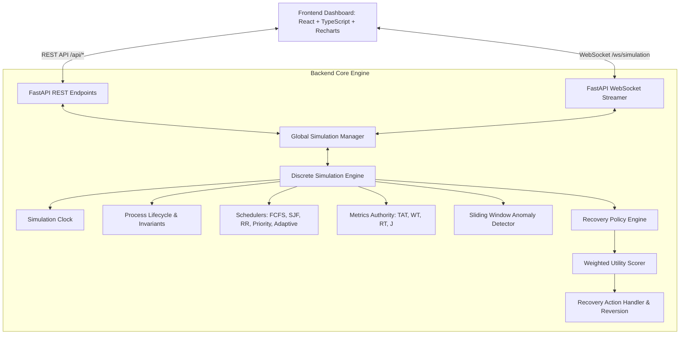

# OS Guardian — An Explainable, Self-Healing Operating System Simulator

[](https://codespaces.new/joshuadjd79-cmd/os-guardian)
[](LICENSE)
[](https://www.python.org/)
[](https://fastapi.tiangolo.com/)
[](https://react.dev/)

> **Operating Systems Course Capstone Project**  
> *A desktop-browser-accessible web simulator demonstrating autonomous anomaly surveillance, explainable recovery scoring, and verified self-healing process scheduling.*

---

## 1. Project Summary & Research Question

Traditional operating systems rely on static scheduling algorithms and rigid heuristic policies that struggle to adapt to volatile bursts of computational contention, process starvation, and memory exhaustion. When resource limits are reached, unmitigated congestion leads to unbounded queuing delays or crude out-of-memory (OOM) process termination.

**OS Guardian** addresses this challenge by answering the core research question:

> *"Can an explainable, adaptive recovery policy improve simulated system responsiveness and resource utilization compared with a fixed-policy baseline, without introducing excessive recovery overhead or unfairness?"*

OS Guardian combines a deterministic, cycle-accurate discrete-time operating system simulator in Python with a real-time sliding-window anomaly detector and an explainable, multi-criteria self-healing recovery engine.

---

## 2. Key Features

- **Discrete-Time Deterministic OS Simulator:** Cycle-accurate simulation clock with explicit process state machine transitions (`NEW`, `READY`, `RUNNING`, `BLOCKED`, `TERMINATED`).
- **Scheduling Algorithm Suite:**
  1. First-Come, First-Served (FCFS)
  2. Shortest Job First (SJF Non-Preemptive)
  3. Round Robin (RR with configurable quantum)
  4. Priority Scheduling with Starvation Prevention (Aging)
  5. Adaptive Recovery-Aware Scheduling Policy
- **Sliding-Window Anomaly Detection:** Detects sustained high CPU, memory pressure, excessive wait times, unresponsiveness, starvation risks, and recovery failures with duplicate alert suppression.
- **Explainable Multi-Criteria Recovery Scoring:** Evaluates candidate self-healing actions using a transparent, weighted utility function.
- **Automated Reversibility & Rollback:** Detects regressions and immediately rolls back ineffective actions.
- **Seven Standardized Benchmarks:** Reproducible comparative workloads evaluating baseline vs adaptive policies.
- **Interactive Web Dashboard:** Dark slate interface built with React, TypeScript, Tailwind CSS, Lucide icons, and Recharts.
- **Educational Safety Boundary:** All processes, bursts, memory allocations, and recovery actions operate strictly in-memory on simulated data models. No real host operating system processes or hardware parameters are modified.

---

## 3. System Architecture



---

## 4. Mathematical Models

Centrally implemented in `backend/app/monitoring/metrics.py` and validated by hand-calculated unit tests:

1. **Turnaround Time ($TAT_i$):**
   $$TAT_i = T_{\text{completion}, i} - T_{\text{arrival}, i}$$
2. **Waiting Time ($WT_i$):**
   $$WT_i = TAT_i - \text{Burst}_i$$
3. **Response Time ($RT_i$):**
   $$RT_i = T_{\text{first\_dispatch}, i} - T_{\text{arrival}, i}$$
4. **Throughput ($\Theta$):**
   $$\Theta = \frac{N_{\text{completed}}}{T_{\text{elapsed}}} \quad (T_{\text{elapsed}} > 0)$$
5. **Jain's Fairness Index ($J$):**
   $$J = \frac{\left( \sum_{i=1}^N x_i \right)^2}{N \cdot \sum_{i=1}^N x_i^2} \quad \text{where } x_i = \frac{\text{service\_received}_i}{\max(1, \text{burst}_i)}$$
6. **Recovery Policy Scoring Function:**
   $$\text{score}(a) = w_1 \Delta R + w_2 \Delta M + w_3 \Delta F - w_4 C_{\text{int}} - w_5 H_F - w_6 R_{\text{rec}}$$

---

## 5. Technology Stack

- **Backend:** Python 3.10+, FastAPI, Pydantic v2, Uvicorn, WebSockets, Pytest
- **Frontend:** React 18, TypeScript, Vite, Tailwind CSS, Lucide React, Recharts
- **Scripts:** PowerShell for Windows 10/11
- **Design:** Dark graphite/slate aesthetic with cyan accents, amber warning indicators, and rose critical badges.

---

## 6. Installation & Launch Experience

### Option A: 1-Click Cloud Launch via GitHub Codespaces (Directly in Browser)

You can launch and interact with the full working model directly in any web browser without installing anything locally:

1. Click the badge: **[](https://codespaces.new/joshuadjd79-cmd/os-guardian)** (or click `<> Code` &rarr; `Codespaces` &rarr; `Create codespace on main`).
2. GitHub will provision a cloud Linux environment and automatically install all Python & Node.js dependencies.
3. In the Codespaces terminal, run:
   ```bash
   ./scripts/run_linux.sh
   ```
4. GitHub Codespaces will detect port 5173 and automatically open the **OS Guardian Simulator UI** in your browser!

---

### Option B: Local Windows Setup & Launch

#### Prerequisites
- Python 3.10 or higher installed and on system PATH
- Node.js v18 or higher installed and on system PATH

#### One-Click Windows Setup
Open PowerShell in the project root:
```powershell
powershell -ExecutionPolicy Bypass -File .\scripts\setup_windows.ps1
```

#### Running the Application Locally
```powershell
powershell -ExecutionPolicy Bypass -File .\scripts\run_windows.ps1
```
The application will launch and provide:
- **Frontend Dashboard:** [http://127.0.0.1:5173](http://127.0.0.1:5173)
- **Backend API:** [http://127.0.0.1:8000](http://127.0.0.1:8000)
- **Swagger Documentation:** [http://127.0.0.1:8000/docs](http://127.0.0.1:8000/docs)

#### Stopping the Application
Close the opened console windows or run:
```powershell
Get-Process python, node -ErrorAction SilentlyContinue | Where-Object { $_.CommandLine -like "*uvicorn*" -or $_.CommandLine -like "*vite*" } | Stop-Process -Force
```

---

## 7. Verification & Automated Testing

Run the automated verification suite:
```powershell
powershell -ExecutionPolicy Bypass -File .\scripts\verify.ps1
```

Or execute testing steps individually:
```powershell
# 1. Run Backend Pytest Suite (22 automated tests)
$env:PYTHONPATH="."
.\backend\venv\Scripts\python -m pytest backend/tests -v

# 2. Run Headless Simulation Verification & Benchmarks
.\backend\venv\Scripts\python .\scripts\verify_headless.py

# 3. Compile Frontend Production Bundle
cd frontend
npm run build
```

---

## 8. Verified Empirical Benchmark Results

OS Guardian was evaluated across 7 standardized workloads comparing fixed baselines against self-healing recovery. Every metric was independently audited from raw simulator measurements (Seed 42). Complete mathematical audits, percentage formulas, and trade-off analyses are documented in [docs/BENCHMARK_VERIFICATION.md](docs/BENCHMARK_VERIFICATION.md).

| Scenario | Workload | Baseline Policy | Adaptive Policy | Key Verified Finding | Result |
| :--- | :--- | :--- | :--- | :--- | :---: |
| **A. Balanced Workload** | 5 tasks, mixed CPU/IO | FCFS | Adaptive RR + Healing | Initial response time reduced by **-48.0%** (20.0t $\to$ 10.4t); WT reduced by **-1.7%** | PASSED |
| **B. CPU Saturation** | 4 long compute jobs | FCFS | Adaptive Dynamic Quantum | Initial dispatch latency reduced by **-91.7%** (36.0t $\to$ 3.0t); Runtime fairness improved by **+2.7%** | PASSED |
| **C. Memory Pressure** | 4 tasks, 1220MB requested | FCFS | Adaptive Reclamation | Peak memory pressure reduced by **21.9%** (100% $\to$ 78.1%) via non-destructive buffer reclaim | PASSED |
| **D. Starvation Vulnerability** | 4 daemons + 1 batch job | Strict Priority | Dynamic Aging + Boost | Starved PID 305 wait reduced from 85t to 60t (**-29.4%**); contention fairness improved by **+0.595** points | PASSED |
| **E. Staggered Arrivals** | 4 staggered jobs | FCFS | Adaptive RR | Waiting time reduced by **-17.6%**; Turnaround time reduced by **-5.1%** | PASSED |
| **F. Zero-Workload Idle** | 0 processes | FCFS | Adaptive | Boundary test: Zero division guards verified; identity fairness $J = 1.000$ | PASSED |
| **G. Regression Safety Case** | 4 ultra-short tasks (3t) | FCFS | Adaptive + Rollback | Reversibility verified: Ineffective actions flagged as regressions and rolled back without progress loss | EVALUATED |

---

## 9. Dashboard Navigation Sections

1. **Overview Dashboard:** Live CPU/Memory charts, active process counts, system health indicator, Gantt execution timeline, and recent events.
2. **Live Process Monitor:** Filterable/searchable process table, process drawer, predefined workload selector, and custom process injector.
3. **Recovery Center:** Active anomaly alerts with numerical evidence, recommended actions, before/after metrics delta cards, and complete recovery audit trail.
4. **Decision Explainability:** Side-by-side candidate comparison matrix, transparent scoring formula breakdown, and rule confidence index.
5. **Experiments & Benchmarks:** Automated comparative runner comparing baseline vs adaptive policies with CSV, JSON, and Markdown export buttons.
6. **Event Timeline:** Chronological event log with filtering by event type and search queries.
7. **Algorithm Laboratory:** Interactive step-by-step simulator, dynamic time quantum tuner, scheduler selector, and ready queue ordering inspector.
8. **Settings & About:** Anomaly thresholds, recovery weights ($w_1 \dots w_6$), auto vs manual mode toggle, educational scope, and safety statement.

---

## 10. API Reference

| Endpoint | Method | Description |
| :--- | :---: | :--- |
| `/api/health` | `GET` | Health check and simulator safety statement |
| `/api/simulation/state` | `GET` | Retrieve authoritative simulation snapshot |
| `/api/simulation/start` | `POST` | Start continuous playback |
| `/api/simulation/pause` | `POST` | Pause playback |
| `/api/simulation/step` | `POST` | Advance simulation by exactly 1 tick |
| `/api/simulation/reset` | `POST` | Reset simulation state to tick 0 |
| `/api/processes` | `GET` | List all processes and timing metrics |
| `/api/processes/workload/{type}` | `POST` | Load a calibrated benchmark workload |
| `/api/recovery/decisions` | `GET` | Fetch complete recovery audit trail |
| `/api/recovery/approve` | `POST` | Approve or reject a pending decision |
| `/api/experiments/run` | `POST` | Execute 7-scenario benchmark comparisons |
| `/api/experiments/export/csv` | `GET` | Download benchmark results in CSV format |
| `/api/experiments/export/report` | `GET` | Download Markdown benchmark report |
| `/api/config` | `GET` / `PUT` | Retrieve or update thresholds and weights |
| `/ws/simulation` | `WebSocket` | Real-time bidirectional streaming |

---

## 11. Publishing to GitHub

To initialize a Git repository and publish your project to GitHub:

```bash
# 1. Initialize Git in project directory
git init

# 2. Add files (respecting .gitignore)
git add .

# 3. Commit the implementation
git commit -m "feat: complete initial release of OS Guardian simulator"

# 4. Link to your GitHub repository
git branch -M main
git remote add origin https://github.com/<your-username>/os-guardian.git

# 5. Push to GitHub
git push -u origin main
```

---

## 12. Academic Deliverables & Course Documentation

- **Benchmark Verification & Math Audit:** [docs/BENCHMARK_VERIFICATION.md](docs/BENCHMARK_VERIFICATION.md)
- **GitHub & Application Security Audit:** [docs/GITHUB_SECURITY_AUDIT.md](docs/GITHUB_SECURITY_AUDIT.md)
- **Live Demonstration Walkthrough (12-Step Script):** [docs/DEMO_SCRIPT.md](docs/DEMO_SCRIPT.md)
- **Live Demo Troubleshooting & Fallbacks:** [docs/DEMO_TROUBLESHOOTING.md](docs/DEMO_TROUBLESHOOTING.md)
- **Academic Research Project Report:** [docs/PROJECT_REPORT.md](docs/PROJECT_REPORT.md)
- **Algorithmic Formal Specification:** [docs/ALGORITHM_EXPLANATION.md](docs/ALGORITHM_EXPLANATION.md)
- **Viva & Defense Guide (38 Oral Questions):** [docs/VIVA_PREPARATION.md](docs/VIVA_PREPARATION.md)
- **Automated Testing & Results Summary:** [docs/TESTING_AND_RESULTS.md](docs/TESTING_AND_RESULTS.md)
- **Final Audit Report & Release Gate:** [docs/FINAL_AUDIT_REPORT.md](docs/FINAL_AUDIT_REPORT.md)
- **Milestones & Contributions Log:** [docs/PROGRESS_AND_CONTRIBUTIONS.md](docs/PROGRESS_AND_CONTRIBUTIONS.md)

