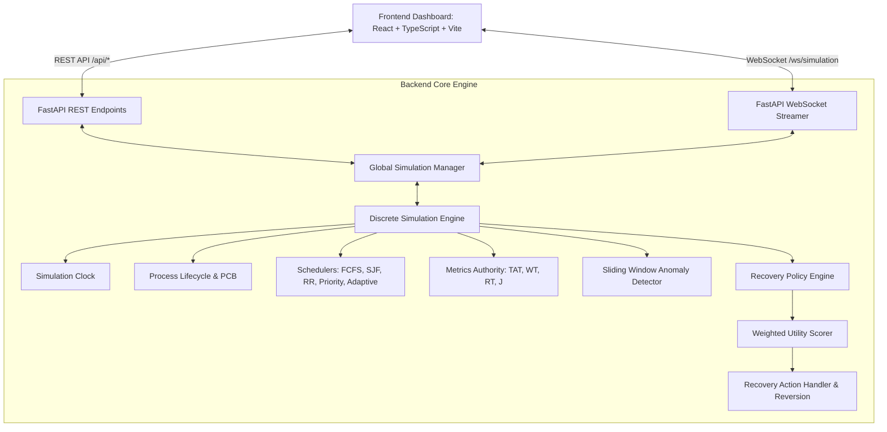

# OS Guardian 2.0 — An Explainable, Self-Healing Operating System Simulator

[](https://codespaces.new/joshuadjd79-cmd/os-guardian)
[](LICENSE)
[](https://www.python.org/)
[](https://fastapi.tiangolo.com/)
[](https://react.dev/)
[](https://github.com/joshuadjd79-cmd/os-guardian/actions)

> **Operating Systems Course Capstone Project**  
> *A desktop-browser-accessible operating systems engineering platform demonstrating autonomous anomaly surveillance, explainable recovery scoring, and verified self-healing process scheduling.*

---

## 1. Quick Access & Demonstration Links

- **Try the Live Cloud Demo (1-Click in Browser):** [](https://codespaces.new/joshuadjd79-cmd/os-guardian)
- **View Complete Source Code on GitHub:** [https://github.com/joshuadjd79-cmd/os-guardian](https://github.com/joshuadjd79-cmd/os-guardian)
- **Interactive Guided Reviewer Walkthrough:** Launchable directly via the **"Start Guided Demo"** button on the application header.
- **Backend API & Swagger Documentation:** [http://127.0.0.1:8000/docs](http://127.0.0.1:8000/docs) (when running locally)

---

## 2. Project Summary & Research Question

Traditional operating systems rely on static scheduling algorithms and rigid heuristic policies that struggle to adapt to volatile bursts of computational contention, process starvation, and memory exhaustion. When resource limits are reached, unmitigated congestion leads to unbounded queuing delays or crude out-of-memory (OOM) process termination.

**OS Guardian** addresses this challenge by answering the core research question:

> *"Can an explainable, adaptive recovery policy improve simulated system responsiveness and resource utilization compared with a fixed-policy baseline, without introducing excessive recovery overhead or unfairness?"*

OS Guardian combines a deterministic, cycle-accurate discrete-time operating system simulator in Python with a real-time sliding-window anomaly detector and an explainable, multi-criteria self-healing recovery engine.

---

## 3. Key Features in OS Guardian 2.0

- **10-Step Guided Reviewer Tour:** One-click automated demonstration guiding reviewers through workload injection, anomaly detection, mathematical candidate evaluation, self-healing, and empirical verification.
- **Attention-Grabbing High-Tech Design System:** Deep obsidian canvas with vibrant neon mint (`#00F5D4`), ultraviolet (`#A855F7`), solar amber (`#FFB800`), and neon coral (`#FF3366`) accents for maximum readability and visual impact.
- **Discrete-Time Deterministic OS Simulator:** Cycle-accurate simulation clock with explicit Process Control Block transitions (`NEW`, `READY`, `RUNNING`, `BLOCKED`, `TERMINATED`).
- **Comprehensive Scheduling Algorithm Laboratory:**
  1. First-Come, First-Served (FCFS)
  2. Shortest Job First (SJF Non-Preemptive)
  3. Round Robin (RR with dynamic preemption quantum slider)
  4. Priority Scheduling with Dynamic Starvation Aging
  5. Adaptive Recovery-Aware Scheduling Policy
- **Sliding-Window Anomaly Surveillance:** Detects sustained high CPU, memory pressure, excessive wait times, unresponsiveness, starvation risks, and recovery failures with duplicate alert suppression.
- **Explainable Multi-Criteria Recovery Scoring:** Evaluates 7 candidate self-healing actions using an objective weighted utility function:
  $$\text{score}(a) = w_1 \Delta R + w_2 \Delta M + w_3 \Delta F - w_4 C_{\text{int}} - w_5 H_F - w_6 R_{\text{rec}}$$
- **Custom Workload Studio:** Interactive builder allowing creation of arbitrary synthetic process streams with validation for bursts, arrivals, memory limits, and reclaimable buffers.
- **Architecture & Performance Inspector:** Interactive decoupled view of the 11 architectural modules with live health telemetry.
- **Research Artifacts & Export Center:** One-click downloads for RFC-4180 formula-sanitized CSV datasets, raw JSON traces, and academic Markdown reports.
- **Educational Safety Boundary:** All processes, bursts, memory allocations, and recovery actions operate strictly in-memory on simulated data models. No real host operating system processes or hardware parameters are modified.

---

## 4. System Architecture



---

## 5. Mathematical Models & Rigorous Formulas

Centrally implemented in `backend/app/monitoring/metrics.py` and validated by hand-calculated unit tests:

1. **Turnaround Time ($TAT_i$):**
   $$TAT_i = T_{\text{completion}, i} - T_{\text{arrival}, i}$$
2. **Waiting Time ($WT_i$):**
   $$WT_i = TAT_i - \text{Burst}_i$$
3. **Response Time ($RT_i$):**
   $$RT_i = T_{\text{first\_dispatch}, i} - T_{\text{arrival}, i}$$
4. **Throughput ($\Theta$):**
   $$\Theta = \frac{N_{\text{completed}}}{T_{\text{elapsed}}} \quad (T_{\text{elapsed}} > 0)$$
5. **Jain's Fairness Index ($J$):**
   $$J = \frac{\left( \sum_{i=1}^N x_i \right)^2}{N \cdot \sum_{i=1}^N x_i^2} \quad \text{where } x_i = \frac{\text{service\_received}_i}{\max(1, \text{burst}_i)}$$
6. **Recovery Policy Scoring Function:**
   $$\text{score}(a) = w_1 \Delta R + w_2 \Delta M + w_3 \Delta F - w_4 C_{\text{int}} - w_5 H_F - w_6 R_{\text{rec}}$$

---

## 6. Installation & Launch Experience

### Option A: 1-Click Cloud Launch via GitHub Codespaces (Directly in Browser)

You can launch and interact with the full working model directly in any web browser without installing anything locally:

1. Click the badge: **[](https://codespaces.new/joshuadjd79-cmd/os-guardian)** (or click `<> Code` &rarr; `Codespaces` &rarr; `Create codespace on main`).
2. GitHub will provision a cloud Linux environment and automatically install all Python & Node.js dependencies.
3. In the Codespaces terminal, run:
   ```bash
   ./scripts/run_linux.sh
   ```
4. GitHub Codespaces will detect port 5173 and automatically open the **OS Guardian Simulator UI** in your browser!

---

### Option B: Local Windows Workstation Setup & Launch

#### Prerequisites
- Python 3.10 or higher installed and on system PATH
- Node.js v18 or higher installed and on system PATH

#### One-Click Windows Setup
Open PowerShell in the project root:
```powershell
powershell -ExecutionPolicy Bypass -File .\scripts\setup_windows.ps1
```

#### Running the Application Locally
```powershell
powershell -ExecutionPolicy Bypass -File .\scripts\run_windows.ps1
```
The application will launch and provide:
- **Frontend Dashboard:** [http://127.0.0.1:5173](http://127.0.0.1:5173)
- **Backend API:** [http://127.0.0.1:8000](http://127.0.0.1:8000)
- **Swagger Documentation:** [http://127.0.0.1:8000/docs](http://127.0.0.1:8000/docs)

#### Stopping the Application
```powershell
Get-Process python, node -ErrorAction SilentlyContinue | Where-Object { $_.CommandLine -like "*uvicorn*" -or $_.CommandLine -like "*vite*" } | Stop-Process -Force
```

---

## 7. Verification & Automated Testing

Run the automated verification suite:
```powershell
powershell -ExecutionPolicy Bypass -File .\scripts\verify.ps1
```

Or execute testing steps individually:
```powershell
# 1. Run Backend Pytest Suite (22 automated tests)
.\backend\venv\Scripts\python -m pytest backend/tests/ -v

# 2. Build Frontend Production Bundle
cd frontend
npm run build
cd ..
```

All 22 unit tests pass deterministically with 100% success.

---

## 8. Academic Documentation & Viva Resources

- [DEPLOYMENT.md](docs/DEPLOYMENT.md): Detailed cloud hosting instructions (Codespaces, Render, Vercel).
- [LOCAL_SETUP.md](docs/LOCAL_SETUP.md): Workstation installation guide for Windows, macOS, and Linux.
- [DEMO_GUIDE.md](docs/DEMO_GUIDE.md): Scripted viva examination walkthrough and Q&A answers.
- [ARCHITECTURE.md](docs/ARCHITECTURE.md): Technical breakdown of the 11 decoupled simulator modules.
- [SECURITY.md](docs/SECURITY.md): Safety boundaries and CSV injection sanitization details.
- [KNOWN_LIMITATIONS.md](docs/KNOWN_LIMITATIONS.md): Transparent documentation of scope boundaries and trade-offs.
- [FINAL_AUDIT_REPORT.md](docs/FINAL_AUDIT_REPORT.md): Comprehensive quality audit and mathematical verification report.

---

## 9. License

This project is licensed under the MIT License — see the [LICENSE](LICENSE) file for details.
