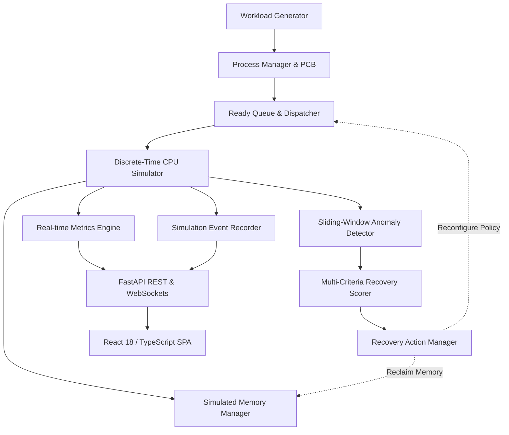

# OS Guardian 2.0 — System Architecture

This document describes the software architecture, component decomposition, and execution model of OS Guardian.

---

## 1. System Decomposition

OS Guardian is built as an 11-module decoupled architecture:

### Module Descriptions
1. **Workload Generator (`experiments/workloads.py`):** Generates deterministic process streams for standardized workloads.
2. **Process Manager & PCB (`core/process.py`):** Manages process control blocks, remaining bursts, priorities, and state transitions.
3. **Ready Queue & Dispatcher (`scheduling/schedulers.py`):** Orders ready processes according to active scheduling discipline (FCFS, SJF, RR, Priority with Aging, Adaptive).
4. **Discrete-Time CPU Simulator (`core/engine.py`):** Discrete clock engine that advances time tick-by-tick and decrements remaining CPU bursts.
5. **Simulated Memory Manager (`core/engine.py`):** Tracks memory usage, limits, and reclaimable buffers without touching host memory.
6. **Sliding-Window Anomaly Detector (`monitoring/detector.py`):** Evaluates sliding windows to detect CPU saturation, memory pressure, and starvation.
7. **Multi-Criteria Recovery Scorer (`recovery/evaluator.py`):** Transparent utility evaluation scoring candidate interventions across responsiveness, relief, fairness, and risk.
8. **Recovery Action Manager (`recovery/actions.py`):** Applies approved interventions (quantum tuning, priority aging, memory reclamation) and handles rollbacks.
9. **Real-time Metrics Engine (`monitoring/metrics.py`):** Calculates turnaround time, waiting time, throughput, and Jain's Fairness Index.
10. **Simulation Event Recorder (`core/engine.py`):** Captures chronological logs for playback and verification.
11. **REST API & WebSockets (`main.py`, `api/`):** Exposes endpoints and streams real-time state to the React dashboard.
